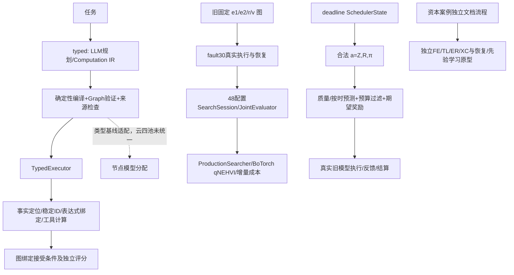

# DAG异构多智能体动态调度：全项目研究状态与论文证据审计

审计日期：2026-10-14（北京时间）。范围：`/root/r3_own_pool`及同项目独立应用`/root/capital_opinion_pilot`。本轮只读取代码和已落盘结果，运行结果文件复算；0真实模型请求、0GPU加载、无新业务DAG执行、无生产代码修改、无Git提交。当前代码与历史实验的代码版本不必相同，二者分列。

**证据等级**：L0文档；L1代码；L2离线/Mock/Stub；L3真实局部调用；L4真实端到端；L5在明确分布、协议及比较内有重复/对照/统计证据。等级不代表所有外部有效性问题解决。报告中的L5均有适用范围，不能推广成“系统整体L5”。

## 1. 一页总览与六个直接裁决

|问题|当前裁决|证据等级|论文影响|
|---|---|---|---|
|Q1 整体做到哪一步？|旧固定DAG真实执行、恢复和配置搜索可运行；新自动DAG在两类开发算术任务上已真实生成并执行正确。**自动规划→云端异构分配→反馈动态联合优化→截止约束净收益**尚无同一协议的完整实证闭环。|局部L4；历史特定对照L5；整条新主线不超过L2/L3接线证据|可以写机制与边界论文，不能写整个联合系统已证明普遍有效。|
|Q2 奖惩解决了吗？|有可执行任务奖励、硬过滤、期望效用决策，也有真实调度行为和新在线先验更新代码。真实旧DD大量降级；新学习收益仍为仿真/开发证据。**不是只有公式，也不是已证明有效。**|公式/联合机制L2，真实旧策略L4，效果优势未成立|若奖励驱动调度是核心贡献，必须补冻结对照或接受负结果。|
|Q3 自动初始DAG完成了吗？|无需人工修图的Qwen-Plus真实图已有：4节点链式及7节点分叉合流，均真实执行正确。稳定生成、独立泛化、公平基线未验证；独立验证接受任务受规则来源接口失配阻挡。|两个开发任务L4；规则接口新版本L2|闭环可行性成立，稳定性和普适性不可宣称。|
|Q4 找到真实复杂组合优化场景了吗？|有分叉合流机制样例和资本事件应用候选；尚未证明其具有不可替代的复杂依赖、可利用的模型差异、真实并发及调度净收益。|合成分支机制L4；自然复杂场景仍候选L2/L3，独立应用有局部L4|不能用七节点或长文档直接证明“复杂DAG优化有价值”。|
|Q5 Q/C/L与动态联合动作跑通了吗？|固定48配置的Q/C/L采集与多目标选择、三种子真实搜索已完成；(Z,R,π)在线联合动作在deadline分支可执行并有真实尝试，但校准与收益不足。配置搜索不等于在线动态联合优化。|搜索L4，限定效率观察；联合奖励策略L4但负面；新自动图接入L2|需把搜索效率、部署代价、调度收益分开。|
|Q6 三个关键阻塞？|①可部署质量/按时概率预测及在线信号可信性；②确有组合优化价值的场景与公平净收益对照；③自动图的规则/验证接受来源闭环及新云模型池接线。|分别存在负面或L2边界证据|前两项关系论文核心收益，第三项关系自动化系统闭环。无需继续重复本地服务预检或无限增加验证规则。|

**最准确定位**：多个可复用研究分支组成的实验平台；已有领域受限的分解损失/静态异构追回证据、局部重执行效率证据、固定配置搜索证据和小样本自动图执行可行性证据；不是已经完成可靠截止保证与通用复杂DAG在线联合优化的统一系统。

本报告新增原始结果复算文件：[RAW_RECOUNTS.json](project_research_audit_20261014/RAW_RECOUNTS.json)。文件范围哈希索引：[EVIDENCE_FILE_INDEX.json](project_research_audit_20261014/EVIDENCE_FILE_INDEX.json)，883个文件身份锚点，**不表示每个文件均逐行审计完毕**。没有遍历API密钥或输出凭据。

## 2. 真实架构：至少四条不同证据链

虚线是未以本轮两张自动图获得统一真实证据的接口，不是已经完成的连接。资本案例银标与主项目数值Gold不混算。

### 2.1 代码调用链

- **自动图**：`generation.py:InitialDAGGenerator.generate` → `computation_ir.py:compile_computation` → `goal_ir.py:compile_goal_ir` → `producer_plan.py:compile_producer_plan` → `semantic_ids.py:assemble_semantic` → `assembly.py:assemble` → `protocol.py:validate`。真实探索启动器为各运行目录`RUNNER.py`；仅实例化当前编译器，不额外调用语义评审模型。
- **自动图执行**：运行目录`RUNNER.py:CloudExecution.call/TraceExecutor` → `execution.py:TypedExecutor.run/inputs/parse` → `fact_semantics.py:ground/bind/evaluate` → `static_dag_v0.decompose_v1:exec_calc`，合流调用`value_join.py:evaluate` → `computation_ir.py:accept_execution`。CloudExecution是独立探索计量适配，不是假造正式StrictMeter证书。
- **旧执行与搜索**：`formal_launch.py:run_campaign/SyncedSelector` → `review/track_b.py:ProductionSearcher.select` → `runtime.py:run_session` → `evaluator.py:SearchSession.step` → `evaluator.py:JointEvaluator.evaluate/MeteredExecutor.call` → `fault30_run.py:eval_config`及`fault30_protocol.py:Ledger/plan_reroute` →节点请求、缓存与独立评分。
- **截止/奖励**：`joint_verification_runner.py:execute/run_cell` → `arm_entry.py:decide_arm` → `policy.py:run_episode/_score_and_pick` → `scheduler_state.py`合法状态、`dag_closure.py`闭包、`reassign.py`模型候选、`predictor.py`及`compensator.py` → `reward.py:expected_rtask`选优 →真实engine →终端`realized_rtask`结算。
- **新云端事件DD**：`full_dag_executor.py:RealRunner.run_task/_recover/_dd_candidate` → `dd_decision.py:choose/expected_task_quality` → `theta_actions.py:PriorStore`。任务完成后`_update_store`读取silver覆盖计数更新先验。真实效用比较大实验尚未发现完成结果，不能由代码或假传输演示推断跑通。

代码证据：[TypedExecutor](collab_scheduler_v1/typed_dag_v1/execution.py)、[编译器](collab_scheduler_v1/typed_dag_v1/computation_ir.py)、[正式启动器](collab_scheduler_v1/joint_search_v1/formal_launch.py)、[真正正式选择器](collab_scheduler_v1/joint_search_v1/review/track_b.py)、[deadline决策](deadline_reward_v1/policy.py)、[事件执行器](deadline_reward_v1/full_dag_executor.py)。仓库存在同名“ProductionSelector”和旧`selectors.py`：不能因名称认为就是正式战役的实现。

### 2.2 模块成熟度矩阵

|模块|实现与连通情况|真实证据|等级/缺口|
|---|---|---|---|
|自然语言自动规划|多协议可选；Computation IR真实云请求|5次当前云序列，3类开发任务|L3；两任务整体L4，未稳定|
|图编译/类型/目标约束|Graph复用、精确生产者、死分支/环检查|2图真实编译并执行|L4；语义无法由结构证明|
|数值事实/引用血统|ground/bind/evaluate与工具计算连通|4事实分支合流、2事实链式均保存位置与hash|L4；单位仍UNKNOWN，语义事实完整需独立审查|
|文本规则来源|新rule_sources外层协议+可选TypedExecutor输入+接受hash|新版本仅17项测试及离线回放，全部534回归|L2；真实新协议未调用|
|节点能力估计|查询画像、节点代理、事件节点先验均有实现|RQ1八题代理、事件FE筛选、旧真实画像|L3；无通用可靠节点质量预测|
|Typed异构分配|heterogeneous_models.allocate类型基线，明确learned=False|三模型加载身份真实；Stage42正常/恢复只Mock|L2分配闭环；加载L3；云自动图均qwen单模型|
|旧静态异构|固定模板节点分配真实可运行|TAT-QA200配对追回+8.5pp|该特定比较L5；不能迁移成新四池结论|
|异常检测|合同、parse、引用、失配、预算等可执行|真实故障/自然输出与重分析|L3/L4；定位不精准，误报存在|
|局部恢复|后代闭包、缓存身份、节点重路由|120题局部/整图、资本案例三注入位置|L4；特定范围效率有对照，质量优势有边界|
|a=(Z,R,π)合法枚举|deadline中三项显式进入决策记录|金场景/Stub＋真实60题策略运行|机制L2，旧运行L4；收益负面|
|期望奖励选优|真实调用前打分、过滤、选动作|微试及确认面板|L4；非RL、未证明奖励优越|
|在线先验更新|PriorStore +任务后更新已接线|仿真及零调用演示；完整新云DD实证未见|L2；silver可用性和无泄漏须审查|
|多目标搜索|官方qNEHVI、状态及增量成本项|六方法×三种子18完整会话|L4；小面板效率方向性，部署无优势|
|真实并发/截止保证|层级拓扑、关键路径估算有；新Typed串行|暂无自动图并发实测；可靠性认证未通过|并发接口L2以下；截止认证未成立|
|整体统一闭环|以上分支尚未同图/同池/同协议统一|不能拼接当成一次端到端|不具备系统整体L4/L5收益证据|

## 3. 节点异常、实例失效与定位审计

**节点异常**是可观测偏离；**执行实例失效**是本次输出无法满足消费者合同；**模型永久故障**没有被这些日志证明。HTTP timeout未知阶段不能直接称Decode失败；来源输入本身没有目标数字，空抽取可能是合理弃权。

|情况|实际检测与位置|Gold依赖/可定位程度|实证边界|
|---|---|---|---|
|JSON/Schema错|TypedExecutor.parse；service_schema.full_validate；IR编译|不读Gold；定位格式字段/节点|真实IR合法、早期输出截断等；Schema PASS不等于计算正确|
|合同违规|protocol.validate、goal_ir角色校验、execution.parse|不读Gold；明确非法端口/类型/符号|真实formula、缺facts、acceptance类型错误，精确合同错误|
|必要事实缺失|fact_semantics.bind/ground；expression输入空facts守卫|不读Gold；只证明已声明引用缺失|不能识别所有未被任务规划声明的必要事实|
|源证据不匹配|ground检查quote/偏移/数值token|不读Gold；词面定位可信|不等于含义正确；small substring旧RQ1仅上界|
|表达式/引用错误|AST白名单、稳定ID、snapshot与单位检查|不读Gold；精确引用违规|真实自动两图ID正确；非法变量守卫离线证据|
|计算/验证不一致|evaluate及verify输出与expected比较|不读Gold；只能证明约束失配|verify_value仅question/value，不是完整原文独立核查|
|超时/API故障|resource_envelope.request_deadline，独立ledger|不读Gold；阶段无服务证据则UNKNOWN|Trace60 B未知usage7629等不能记零|
|截止风险|predictor.e1_on_time+policy阈值|不读Gold；是预测信念不是已认证概率|真实可靠性多格低覆盖；不能精准定位“模型迟到原因”|
|上游污染|绑定血统、后代闭包、versioned输出|不读Gold，但因果诊断不充分|旧r错延迟至v暴露会错修v，不能称精确根因定位|
|输出语义质量低|终端score_v21/Gold；事件silver评分|执行后Gold或开发silver|“parse成功/非空”不是质量检测；在线银标评估不等于部署可得信号|
|预算违规|Budget/StrictMeter/探索独立派发记录|不读Gold|历史跨重启请求超额与KDX输入漏预留均真实过程失败|

检测实现：[detection.py](deadline_reward_v1/detection.py):D1/D3/D5/D6；[Typed严格语义](collab_scheduler_v1/typed_dag_v1/fact_semantics.py):ground/bind/evaluate；[错误与恢复](collab_scheduler_v1/typed_dag_v1/execution.py):run/recover_failed。D2/D4在早期检测器中是恢复族位置，不可默认已在planned阶段触发。旧镜像曾对围栏JSON、string facts、合法减法误判，后续修复；历史运行须使用当时版本解释。

真实检测诊断：[frozen200_p1a/REPORT.md](static_dag_v0/frozen200_p1a/REPORT.md)。41个r注入事件：异常最终暴露33/41，正确定位16/41，正确定位后的修复6/16；部分延迟失配误修v。健康任务触发380/420是将fallback解释为干预信号后的90%触发率，**不是直接的正式故障检测器FPR**。接口错误检测容易，语义错而格式合法可漏检。不要将该报告中的退役Dynamic=0.4033整体收益再作现行结论。

RQ1反转：[rq1_node_capability/RQ1_REPORT.md](collab_scheduler_v1/joint_search_v1/rq1_node_capability/RQ1_REPORT.md)含v3支撑审计。17/17和16/16并非独立任务；缓存别名分别13、14。恒为8个任务，每格真执行1–4；五题目标操作数只在表格，文本抽取非空可能无依据。supported_ok large .265(n=34)、medium .200(n=15)仅词面上界，不支持能力排序或调度收益。

## 4. 奖惩机制：公式、策略耦合、实效分别裁决

### 4.1 可执行数学定义

[reward.py](deadline_reward_v1/reward.py):realized_rtask：

\[
R=\mathbf1(T\le D)q-\lambda_c C_{full}/C_0-\lambda_t(T-D)_+/D-\lambda_f\mathbf1(T>D).
\]

决策阶段expected_rtask：

\[
\widehat R=\hat p_{on}\hat q-\lambda_c\Delta C/C_0-\lambda_t\mathbb E[(T-D)_+]/D-\lambda_f(1-\hat p_{on}).
\]

q为任务质量；C0成本归一化尺度；D冻结任务期限；λc/λt/λf分别成本、超时程度、超时事件权重。新云事件[full_dag_protocol.py:utility](deadline_reward_v1/full_dag_protocol.py)冻结λc=.5、λt=1、λf=2、C0=60000 Token。旧不同协议权重不能自动套用。

- 质量提升在按时条件下提高奖励；迟到质量项归零。
- 成本全量罚款；选择只比较可控增量，结算计完整或明确conditional口径。
- 非超期的小幅时延增加没有独立线性罚项，但降低按时概率/增加迟到风险会降低期望效用。
- 节点失败没有通用独立λnode项；通过终端q、恢复新增成本、迟到和degraded传播影响效用。λf是**迟到事件惩罚，不是所有节点failure罚项**。
- 恢复成功无独立bonus，奖励来自最终q和按时性改善；会付新增恢复成本。
- settle的session_bonus/penalty是一次终端项，不是每恢复节点重复奖励；该函数还保留stub_test_only标记，不能把所有调用默认当生产结算。真实joint_verification另有dual reward路径。

### 4.2 A/B/C/D分类

|机制类别|实际状态|不可扩大解释|
|---|---|---|
|A固定加权效用|已实现、进入选优与结算|不是策略学习|
|B约束罚/硬过滤|policy硬过滤Qmin、按时信念、剩余成本；DD-v2软风险与静态回退|预测约束未认证成部署安全保证|
|C反馈在线更新|SearchSearcher吸收评估；PriorStore任务后pass/recall更新、Wilson/Thompson|查询路由和节点调度不同；silver更新不一定在线可得|
|D强化学习|未见已验证的MDP/策略梯度/长期回报训练闭环|Thompson属于bandit型探索，不等同完整RL调度算法|

[policy.py:_score_and_pick](deadline_reward_v1/policy.py)把(Z,R,π)、质量、μ/P90、预算、switch、可行性、违约向量记录后选最高期望奖励；不只是离线打分。[full_dag_executor.py:_update_store](deadline_reward_v1/full_dag_executor.py)对完成任务使用silver原子覆盖更新(model,θ)桶。这个机制是可执行C类，但没有新自动DAG的统一真实学习收益证据；silver只有离线评测可得时不能声称无标注在线部署学习。

### 4.3 真实效果：有行为，没有正向保证

[微试报告](JOINT_VERIFY_MICROPILOT_REPORT.md)：3任务×6臂，29真实请求/10449 Token，46缓存/7注入，全部结算；DD部分EARLY_STOP，NONE和MONO各有按时正确个例。目的为接线，不可证明DD优越。

**直接重算60题已完成确认文件**：[confirmatory_runs/JOINT_VERIFY_RESULTS.json](deadline_reward_v1/confirmatory_runs/JOINT_VERIFY_RESULTS.json)，469请求/185843 Token，所有臂COMPLETE。以下是独立复算描述值，不增加显著性宣称：

|臂|正确/60|降级/60|臂物理Token总量|平均R_conditional|
|---|---:|---:|---:|---:|
|SS|21|0|44350|.25760|
|DS|2|46|4984|.02295|
|SD|2|46|4984|.02295|
|DD|2|46|4984|.02295|
|NONE|20|0|17283|.29733|
|MONO|28|0|33908|.39603|

**裁决**：奖惩确实影响动作，动态臂真实大量拒绝/降级；不能把省Token解释为成功优化。该运行暴露先验/争用/可行性问题，是负面边界证据。R_conditional是相同post-fault状态的服务时延机制量，不是含base、队列、模型加载的完整部署奖励；文件仍残留caps_note“60/25K proposal”，而实际469请求，必须以对应launch审批与budget账本确认真实额度，不能将该模板字段当违规证据，也不能盲称其已核验。

[DD_V2_EXEC_CLOSURE.md](DD_V2_EXEC_CLOSURE.md)和[DD_V2_DEV_RESULTS.md](DD_V2_DEV_RESULTS.md)证明soft风险同池选优、实测服务先验、proxy区间和静态回退已修复接线；`dd_v2_dev_runs/DD_V2_DEV_RESULTS_INCOMPLETE.json`实际GPU busy、无完整臂结果。**修后代码通过不追溯修复旧运行，不构成新正向真实试验。**

[DD_ROUND_DEV_REPORT.md](deadline_reward_v1/DD_ROUND_DEV_REPORT.md)的新DD v3加入Thompson+健康槽均值+下游传播，模拟能转向真实最优候选；尚属机制L2。没有完整的真实无奖惩/权重消融/在线学习优越性对照，缺的是可部署信号与效果验证，不是再写奖励公式。

## 5. 自动DAG：生成与真实执行最新证据

### 5.1 各层责任

Prompt负责声明操作含义、目标反推和来源选择；JSON模式只促使JSON返回，不是服务端完整Schema保证。程序full_validate检查完整Schema与字段条件；编译器分配ID、解析唯一符号、按已有operation绑定端口、检查类型/单位声明、环、目标、死分支和接受输出。**事实选择、运算意图、规则使用仍需模型规划及独立审查**。

原直接Graph、semantic/input_producers、goal_ir、Computation IR路径均保留于[generation.py](collab_scheduler_v1/typed_dag_v1/generation.py)，不能认定它们的历史试验同分布同Prompt。`aggregate_values`消费两个以上已计算数值，显式公式仅引用这些符号，工具求值并保存各输入血统；不能把expression变facts。多源facts与多value合流是两种合同，不可混称。

### 5.2 当前Qwen-Plus探索序列逐项清点

全部同一别名qwen-plus，但提示和Schema版本逐轮变化；表中“计划意图”是助手独立离线审查，没有额外LLM审查请求。

|运行目录（Typed目录下）|真实请求/Token|JSON/Schema|编译与独立审查|后续执行|
|---|---:|---|---|---|
|stage53_qwen_exploratory_real_01|1 /2365|通过|goal未产出；另有非join formula违规，拒绝|无|
|stage53_qwen_exploratory_real_02|1 /2689|通过|4节点4边；意图通过、保留运行边界|auto_e2e_real_01真实完成|
|stage53_qwen_branch_join_real_01|1 /3245|通过|普通calculate值误放acceptance，拒绝|无|
|stage53_qwen_branch_join_real_02|1 /3318|通过|7节点8边；两来源及显式数值合流，意图通过|branch_join_e2e_real_01真实完成|
|stage53_qwen_acceptance_real_01|1 /3279|通过|五步保留规则及独立验证，但ctx_text数值来源路径缺失，拒绝|无|

目录基址：[typed_dag_v1](collab_scheduler_v1/typed_dag_v1/)。各目录`RESULT.json/RAW_COMPUTATION_IR.json/VALIDATION_ERROR.json/CALL_LEDGER.jsonl`为原始证据。合计5请求14896 Token、3个开发任务族；HTTP/JSON/Schema5/5，编译2/5（40%）。**不是固定协议成功率**：同题重复且针对错误改Prompt，分母是尝试，不是5个独立任务。

计划意图完整且可接受2/5；第三题规则语义保留却未通过来源协议，不能将所有拒绝笼统归为模型没理解任务。受完整准入的两个候选均执行成功2/2；尝试级完整链成功2/5。这些比例仅描述当前自适应开发序列，无法估计稳定生成率或跨分布泛化。

### 5.3 不再只是“准备”：两个真实端到端结果

|证据|节点/边|真实执行|质量|来源和接受|
|---|---|---|---|---|
|[stage53_auto_e2e_real_01](collab_scheduler_v1/typed_dag_v1/stage53_auto_e2e_real_01/EXECUTION_RESULT.json)|4/4|3次云LLM+1工具，1252 Token，DAG约4秒|63.0，与执行后Gold一致|84、21定位和fact_id绑定；verify_value真实调用、血统值一致；最终输出来自验证节点|
|[stage53_branch_join_e2e_real_01](collab_scheduler_v1/typed_dag_v1/stage53_branch_join_e2e_real_01/EXECUTION_RESULT.json)|7/8|4次云LLM+3工具，2301 Token，DAG约6.81秒|39+31=70.0，与执行后Gold一致|46/7、35/4两来源和派生血统汇合；无验证节点，acceptance为空|

COMPILE/EXECUTION/TASK/PROVENANCE在两个任务的既有合同下通过；第一例verification是在既有数值一致性范围生效，不是实测故障检出率。第二例无验证节点，不能从accept_execution=True推断“验证成功”。两者units仍unknown（liters/documents未被词面单位器识别），独立数值正确不代表自动单位认证；不把4或6.81秒启动器墙钟冒充含开发/报告的完整实验时长。

两次成功生成＋对应执行费用Token分别3941、5619；全部当前探索生成与节点执行已知Token18449（含失败规划，实际账单均待核验）。历史其他实验不并入该总额。

### 5.4 当前规则修复与泛化缺口

[rule_sources.py](collab_scheduler_v1/typed_dag_v1/rule_sources.py):compile_rule_plan/compile_with_rules/validate_envelope新增**可选新版本**，规则独立source span/hash/consumer，执行Prompt的task_rules与缓存hash、accept_execution送达/hash约束已接线。534回归含17项新增，真实新版本生成与执行均尚未发生。历史INVALID保持不变，离线人工bindingfixture不是真实LLM成功。

生成图能被TypedExecutor直接使用；不能“直接交给整个旧优化器”：`evaluator.space()`、fault30、deadline M1–M6等大量模块仍绑定e1/e2/r/v菜单、角色与动作。Typed自身支持变量节点数/任意ID，不代表旧SearchSession评价和新云四池已通用。没有人工DAG、无约束LLM、直接Single公平配对实验，无法评估分解净收益；无真实结构优化或结构—模型联合搜索。

## 6. 真实场景与数据集适用性

### 6.1 全量计算结构普查复核

[task_complexity_census.py](static_dag_v0/task_complexity_census.py)解析TAT-QA train/dev derivation与MultiHiertt qa.program，测算**算术操作DAG**；不是自然语言所有信息处理工作流。输出[task_complexity_census.json](static_dag_v0/task_complexity_census.json)：

|数据|全量题数|解析计算题|全题≤3操作|计算题≤3操作|计算题分支|全题strict_complex|
|---|---:|---:|---:|---:|---:|---:|
|TAT-QA|14883|6579|99.1%|98.0%|1.5%|0.7%|
|MultiHiertt|8874|7078|90.0%|87.5%|2.6%|3.9%|

TAT n=14883不能当成全公开所有split，解析失败/非计算与分母不同；MultiHiertt arithmetic标注7148但解析7078。程序的“schedulable”“strict_complex”是操作图启发式筛选而非实测LLM可调度性。特别是全题≤3比例用`(n_ops or 0)`，无法解析的None也按0计入，因此99.1%/90.0%是该解析口径的存档统计，不是对所有未知题计算复杂度的完备证明；计算题分母及解析失败须同时报告。最大**层宽**不是所有DAG的最大反链并发度证明。结论：这些分布主要浅层、链式，可以验证机制与适用边界，不足以证明通用复杂DAG动态调度优势。

### 6.2 场景逐项判断

|场景|结构与优化空间|证据与裁决|
|---|---|---|
|TAT-QA常规财务算术|大量单步/浅链；旧四节点是抽取/推理/验证模板|有分解损失和模型重新分配实测，不是复杂图场景证据|
|MultiHiertt|多表/文本较多，但多数计算链；部分≥4操作可筛候选|真分支比例小；长输入不等于并发依赖；候选需逐任务审定|
|现有七节点开发任务|两批总量减失败再和；3个算术操作，7节点是合同阶段展开|真实分支及血统汇合成立，但题目明确要求分支保持，数学上可改写单表达式。机制样例，不是复杂场景泛化证明|
|采购工作流run_v0|4领域模板节点，20构造任务|静态真实执行曾误差传播严重且分配全large；不是异构收益证据|
|资本事件FE/TL/ER/XC|证据抽取、时间线、主体关系及核查，存在角色异质与缓存/恢复|自然文档流程有候选价值，但银标、同文档核查、解析失效和上下文限额需边界说明|
|康得新当前A图|6节点7边、关键路径5、层宽2，五文档347分段|结构、检索、身份预检证据≠完整事实覆盖与执行；CONFLICT/UNKNOWN存在|

**尚未找到“已充分验证、值得优化”的自然复杂DAG场景**：存在候选及局部恢复例，缺跨节点真实性、不同模型任务级边际收益、直接Single公平预算与真实并发/关键路径对照。配置数48/81和7节点本身不能作“真实优化空间”证据。

### 6.3 资本案例必须独立报告

[capital V3_KDX_CONTRACT_REPAIR_REPORT](../capital_opinion_pilot/V3_KDX_CONTRACT_REPAIR_REPORT.md)：A经真实LLM修复6节点合法、B截断；2调用4096/4000超96的原始过程失败必须保留；多facts合并仅Stub，不是成功自动资源感知策略。A单extract计划曾要求127598字而可注入约3300字，表明结构合法≠执行可行。后续347分段检索与t2 V3预算准备不能回写旧计划成功。

[独立旧KDX动态恢复](../capital_opinion_pilot/V3_KDX_QCL_D_REPORT.md)：3个注入位置、8恢复调用/15361 Token，完成性3/3，Q=.4286回到干净C臂水平，引用.67–1。全下游重跑8082是记录/估算参照，不是新增三条配对实测臂；不把报告的“CONFIRMED”写成统计确认。该旧C输出续跑证据**不能替代当前A图新端到端执行**。

[CAPABILITY_AND_S6_INVALIDATION_MAP](../capital_opinion_pilot/CAPABILITY_AND_S6_INVALIDATION_MAP.md)明确撤回模型跨源能力Q=0与S6 NONE正确性主张，原因是解析错配。后续数据须逐版本审定，不能只选有利恢复表。

[可信共享服务实测](../capital_opinion_pilot/trusted_shared_real_preflight_20261013_201914/REPORT.md)：Qwen2.5-7B/vLLM0.11.0加载身份、健康与清理PASS_METADATA_ONLY，44.689秒、0生成Token。不是t2抽取或DAG执行，也不应再重复这类预检替代研究证据。

## 7. Q/C/L、截止与算法实装

### 7.1 模型池不可合并

旧`static_dag_v0/run.py:MODELS`：medium=Qwen2.5-7B；large=Qwen2.5-14B GPTQ Int8；coder=Qwen2.5-Coder7B。旧查询画像、48配置与deadline实测绑定此池。

新云候选在`deadline_reward_v1/full_dag_executor.py:real_call`：GLM-5.3/Flash走bigmodel anthropic messages；deepseek-flash走api.deepseek；qwen-plus走dashscope OpenAI兼容chat。模型名大小写和API协议必须保留；各服务动态版本只记录返回身份，无统一权重固定证据。仅配置四名字不是四池正式泛化验证。

[FE_PAIRED_REPORT](deadline_reward_v1/FE_PAIRED_REPORT.md)20次实测同提示、默认2048输出下前三思考模型15/15截断/空、Qwen5/5JSON成功，是**思考参数×输出契约**差异，不是模型能力高低排名。参数恢复[PARAM_RECOVERY_RESULTS.json](deadline_reward_v1/PARAM_RECOVERY_RESULTS.json)中DeepSeek禁思考变完整输出；引用doc_id可仍0匹配，格式恢复不等于证据正确。GLM费率在full_dag现金函数为0/UNKNOWN未认证，不能写“免费”。

### 7.2 统一问题尚不统一

DAG、候选模型、缓存闭包、增量成本、反馈均有数据结构。Q聚合不同分支用min/product/终端精确得分/银标覆盖，L有串行服务、max抽取关键路径、批sojourn、含切换queuewall等至少四种；不得并成一个定义。

`policy._score_and_pick`确有三过滤：q_mean≥qmin，p_on≥1−eps，predicted增量成本≤remaining，并记录合法execute/reuse与R闭包；无可行动作为EARLY_STOP。`predictor.e1_on_time`含Normal/Lognormal/离散阶梯等声明族；min/product独立性等不是经过真实任务广泛校准的Q与概率。

[RELIABILITY_ROUND_CLOSEOUT](deadline_reward_v1/RELIABILITY_ROUND_CLOSEOUT.md)：1257物理请求对1200信封超57；有效结算502417 Token＋4629异常保留，跨重启不重复预算控制失败，不能写合规完成。10格P90覆盖6格低于.90；FIT两个重复同24任务同身份仅证明同条件稳定，不是跨任务可靠；争用阶段未启动，认证NOT_ESTABLISHED，该路线已明确关闭，不应重复无限校准。

### 7.3 搜索三目标与在线动态动作必须区分

正式入口使用`review/track_b.ProductionSearcher`，非旧`selectors.SelectorState`；真实评分Q/C/L进入observations，qNEHVI在Q、Cnorm、Lnorm上计算。候选C和L估算来自deployment_cost，`cand_arrays`二者均为`1-dep/Cmax`，**候选时延预测实质为成本代理，不是独立校准时延模型**。采集函数有三个坐标不等于可靠三目标决策。

- Random：候选均匀采样。
- Scalarized：固定轮转权重的GP均值＋C/L代理；不可一概叫标准ParEGO或EI。
- qNEHVI：官方BoTorch实现，用统一输入与目标。
- Proposed：状态分层评价分数均值，再除预测新增成本。
- 无状态/无成本消融：同算法中关闭相应项。

正式空间固定`evaluator.space()`为2^4×3=48个X+Z配置；不是搜索自动DAG结构，R由恢复规则派生。SearchSession跨配置吸收面板评估，区别于同一任务中收到故障后联合选择动作。SA-PGFS仿真、Cube查表replay和真实Formal应三列报告。

### 7.4 正式搜索终局与成本双口径

[formal_final/FORMAL_FINAL_REPORT](collab_scheduler_v1/joint_search_v1/formal_final/FORMAL_FINAL_REPORT.md)及[settlement_audit](collab_scheduler_v1/joint_search_v1/settlement_audit_ro/FORMAL_SETTLEMENT_AUDIT_RO.md)：6方法×3种子18完整会话。8题面板全部达到Q=.5，状态消融无质量差。首达fault30 .5额外物理请求Proposed均值56，qNEHVI65，无增量成本65；三种子配对−13/−9/−4。无状态56，配对0/−1/+2，未见状态收益。

部署侧qNEHVI族选择更稳定且最便宜，Proposed种子1选最贵配置。只能写增量成本项与少量搜索效率收益解释一致，不能“全面优于”或“动态部署净收益”。n=3不做强统计主张，TEST16未启动。

完整轨迹4542请求/1620410 Token；全信封已记4871/1743814，含失败原尝试消耗。random crash有未匹配8192保留且未计入某settle；缺STATUS墙钟，原对账PASS仅指已记录金额相等，不是全部未知债务证明。缓存公平须按cold部署与搜索物理分别记账。

## 8. 静态/动态及论文数字逐项核查

### 8.1 可引用配对主线

[decomposition_benchmark/DECOMPOSITION_PAIRING_AUDIT](static_dag_v0/decomposition_benchmark/DECOMPOSITION_PAIRING_AUDIT.json)、[paired_decomposition.py](static_dag_v0/paired_decomposition.py):freeze/run，以及[DAG_MAINLINE_EVIDENCE_AUDIT](DAG_MAINLINE_EVIDENCE_AUDIT.md)引用的原始paired_run：300任务（TAT200＋MH100）。

- TAT n=200 Single-L52.5%、同模型DAG31.5%，−21pp，p=4.3e−7，CI[−28.5,−13.5]；832→1092 Token，服务2.02→2.28秒。证明整个分解管线损失，不可孤立归因“DAG结构本身”。
- 同面板异构推理节点分配→40.0%，+8.5pp，p=.0015，CI[3.5,13.5]；成本接近，追回约40%损失，仍低Single12.5pp。
- MH100 Single11%、同模DAG17%、异构15%，域差异明显，不支持统一收益。
- E2 context passthrough35.0%、gold-facts27.0%；后者同时改变值与索引/格式，不是纯事实准确性因果消融。不能用Gold事实替换负结果否认抽取误差作用。

### 8.2 局部恢复与全图重放：注意两个更正版本

`corrected_replay/CORRECTED_REPORT.md`中RD40%/FG37.5%、p=.25属于此前parser更正。后续论文[FINAL_AUDITED_RESULTS](paper_method_feedback_aware_dag/FINAL_AUDITED_RESULTS.md)及[DAG_MAINLINE_EVIDENCE_FINAL](DAG_MAINLINE_EVIDENCE_FINAL.md)控制E3/E4引用：n=120，局部36.67% vs 整图33.33%，Help/Harm4/0，p=.125。**不是把40.0的TAT异构臂或这组局部臂当一个数。**

局部范围token/calls/service节省约33%/50%/38%支持效率机制；质量差异未显著，不是等效或非劣证明。故障态Dynamic-vs-Static有+7.5/+8.9/+9.7pp跨档位观察与配对p≤.001，但存在后续修复路径覆盖不全的audit overlay，应探索性引用，不作为新冻结协议确认结果。

[dynamic_v2_confirm_250/CONFIRM_ANALYSIS](static_dag_v0/dynamic_v2_confirm_250/CONFIRM_ANALYSIS.json)：n=250，ΔQ=.028，CI[−.008,.064]，Help/Harm13/6，p=.1671，NOT confirmed；不能因正点估计声称收益已证实。

### 8.3 必须撤回或保持PENDING

- Reference Cube旧f30_dynamic=.4033被退役，现[REFERENCE_CUBE.json](collab_scheduler_v1/REFERENCE_CUBE.json)更正为.3433，global front clean/fault均Single；“故障使全局前沿扩张为Single+Dynamic”撤回。
- Exact54组合、Frozen缺输出、56%workflow scheduler在[最终证据裁决](DAG_MAINLINE_EVIDENCE_FINAL.md)被BLOCKED；`horizontal_comparison.json`存在.56不是可引用真实性认证。
- `STATISTICAL_REPORT.md`的50题×8臂×4态×两协议确认终点PENDING。`netbenefit_audit_ro`独立确认真实仅3个cleancell，252请求102894 Token，其余Stub。所以“完全从未执行”也过时，准确说法是**仅部分基线执行，主D/E/fault比较未完成**。
- `FINAL_INTEGRATION_REPORT.md`旧双目标或早期selectors“official blocked”描述被正式track_b接线替代；L坐标存在，但代理限制需保留。
- `DAG_MAINLINE_EVIDENCE_FINAL.md`E5两种子速度结论被三种子终局补充；不应按“最后一个报告文件”机械覆盖所有分支口径。
- 查询路由[experiment_ridge_confirmation_100](router_v2/experiment_ridge_confirmation_100/REPORT.md)：Routed68.8 vs R1 69.2，−.4pp，未确认；不能将查询侧学习等同节点级能力或调度增益。

### 8.4 研究证据链当前完成度

|环节|现有证据|仍缺|
|---|---|---|
|分解损失|TAT200强配对结果，域依赖|新自动规划跨任务分解质量和净开销|
|异构追回|静态节点更换+8.5pp|新四池与新自动图的可靠节点能力优势|
|动态恢复收益|局部范围效率，故障机制局部观察|无gold部署信号、校准、质量净改善独立确认|
|净收益判定|Single在多个整体面板占优；确认结果PENDING/负|同任务、预算、端到端墙钟含规划与恢复的公平对照|
|条件化调度|代码可执行，奖励驱动行为；Formal state消融空|合法动作真实状态分化且收益大于估计/探索开销|

**没有证明“动态DAG在一般情况下弥补全部分解损失和额外开销”**。适用条件应明确，不应消除负结果以维护预定论点。

## 9. 核心阻塞、工程风险与可暂缓事项

### P0阻塞

1. **质量与期限信念是否支持真实动作**：历史parse/非空≠quality，叠加推测分布与本地切换使p_on过滤失真；真实DD46/60降级。必须先证明信号可部署且动作选择不由错误先验/银标oracle驱动。
2. **收益问题与研究对象匹配**：浅算术Single常占优；七节点是阶段展开，资本长文档有语义/引用需求但弱Gold和已撤回能力表。没有自然复杂任务中的真实净收益，论文“复杂DAG优化”过宽。
3. **新自动图统一闭环缺失**：规则协议L2，云四池不等同旧本地池，通用图不能直接进入四节点e1/e2/r/v决策空间。需要最小适配和接线证据，而非新建并行大系统。

### 不应继续作为无限启动门禁的事项

模型可能规划错误、截断、来源语义遗漏属于应测失败；无法证明所有合法图均在2048/4096输出中完成属于研究边界。正式严格输入/费用证书缺失仍是真正预算门禁；已明确接受风险的探索协议可独立运行，不能把估算写成认证。GPU共享协调是特定本地资源门禁，当前云探索不需GPU；无需再重复元数据预检。

全过程墙钟：近期执行启动器墙钟有记录，开发准备/报告完整统一起点UNKNOWN；今后一个launch全程计时即可，不必展开新平台。云输出费用为响应usage推算/待账单，不能用估算现金作为严格保证。历史跨重启超额1257/1200和KDX4096/4000保留，不“审计通过”洗掉。

## 10. 下一阶段优先级与最应该做的一项实验

**最优先实验：一个冻结、图结构确有必要信息汇合且存在两个合法恢复动作的开发任务，做云端“固定策略 vs 反馈联合策略”配对最小机制试验。**先零调用审定来源/合同及可部署反馈，必须自然出现或按公开协议注入明确合同失效，禁用Gold/银标进入决策；同一任务条件、相同模型池和输出模式，控制模型思考/格式参数。它直接回答核心贡献是否被真实触达，比继续同题Prompt生成、重复Qwen服务加载或扩大随机搜索更有价值。

若可部署质量先验及动作合法性尚不够，先完成所需的零调用检查，**不强行付费**。可以复用现有合法手工/自动图，明确图来源；不要求用又一轮自动生成成功才能检验已实现的调度机制，也不能把手工图当自动成功。

|优先级/建议|科学假设与缺证据|复用实现|调用/资源及时间估计|成功/失败含义与RQ|
|---|---|---|---|---|
|P0-1 最小真实动态联合机制对照|同一可观测合同失败下，状态/成本能使合法(Z,R,π)动作不同且执行闭环；现有60题降级问题需避开未经支持先验|policy/dag_closure、dd决策、Typed血统、云传输|先1任务×2策略，按冻结G中LLM数m及各R的LLM数r计最多2m+r1+r2，无额外模型审查。若m=4且两R各2，则≤12请求；不能未经图审定沿用该上限。按现有节点0.6–1.8s及复杂FE6–30s只作经验区间；建议硬客户端15分钟须单独审批，不本轮执行。无需GPU|成功只证明机制被真实触达；失败区分信号/预测/动作/执行，不能换题到成功。RQ动态联合动作|
|P0-2 场景资格与净收益小配对|分叉、共享、局部恢复有净价值，而非人为拆分|complexity census、静态baseline、评分合同|离线先筛5候选，审定1–2自然任务；Single+同模图+异构图，预算精确为每题1+2m请求（无恢复）加规划成本另册。1–5分钟/题仅低延迟简单云经验，长文任务UNKNOWN，需测量后冻结。无需GPU|负结果可缩窄论文；成功才值得扩大样本。RQ分解/异构净收益|
|P0-3 自动规则协议一次真实生成/执行|新rule_refs由LLM声明，来源送达和独立验证接受真实生效|rule_sources、Typed可选envelope、accept_execution|一次生成2048输出，120秒客户端；通过后另批m次节点调用，每次≤512，m由真图定。1生成+4节点是当前五步候选经验，不作新图先验保证。输入/费用上界未认证，探索须接受风险。无需GPU|成功=第三种接口闭环，不是泛化；失败如实归因。RQ自动初始化|
|P1 独立重复/样本对照|质量/截止/策略差异稳定且有可估计效应|冻结uid/prompt、配对分析、账本|先用P0真实Help/Harm估功效，再冻结n；不能盲称n50足够。调用数按臂与恢复闭包乘n，费用和墙钟实测估。无需GPU若云|置信区间和净收益确认，不把无显著差异写等效|
|P1 奖励消融与质量预测误差|权重/过滤确实改变收益而非仅少调用|现有λ切换测试、预测-实测记录|优先对已落盘决策离线重算，再选择少量新真实配对；不必重新跑全部60。时间离线分钟级；调用预算待协议|定位奖励耦合还是预测误差；RQ奖惩有效性|
|P1 成本/延迟口径统一|规划、接口、恢复开销是否反转净收益|已有usage/单调时钟/ledger|0新模型调用可完成已有结果合计；真实实验用一个总起点，费用核账只在授权账户读权限范围|解决报告完整性，不以新模块替代研究|
|P2 并发/结构搜索/RL/全面四池扫描|在P0场景证明可优化之后再测|拓扑layers、aggregate工具、现有MOBO|当前不建议调用；真实并发须端到端测量且独立资源审计|锦上添花，不能救缺失净收益的核心论点|

论文必须补的是“真实动作被反馈/奖惩改变且公平代价下是否有效”，不是把每个开发题修到全通过。结构搜索、全四池画像、完整RL、进一步本地隔离开发、无穷重试均可暂放。

## 11. 论文可写与不可写，以及最终六问

### 可写

- TAT式任务中分解管线有显著损失，静态异构可部分追回；域差异及仍落后Single应同报。
- 在已执行恢复轨迹中，依赖合法局部重执行有范围效率收益，质量差异未显著。
- 固定配置Formal搜索的小面板下，增量成本项与少量搜索效率收益一致，状态项未显示收益；不能延伸部署优势。
- 两类开发任务中，Qwen-Plus生成未经人工修图的Typed DAG并真实执行正确，源事实及派生合流血统可追踪。
- 契约不相容、源缺失、规则文本表示、预测失配是可检验失败机制，不应隐藏。

### 不能写

- 所有复杂任务DAG优于Single；模型四池能力已排序；动态分配在线优势已确认。
- P90安全认证完成、GPU锁不可绕过、客户端timeout证明远程取消、单位维度已验证。
- 七节点或长文档就证明组合优化复杂度；真实分叉就是实测并行；配置空间大就是可利用空间大。
- 新规则离线修复等于历史真实通过；重复任务自适应生成比例就是独立泛化率。
- 奖惩机制已经解决净收益、Thompson机制就是全RL、Stub奖励/模拟正结果就是真实提升。

**Q1**：项目是多个真实实验分支加新自动图局部闭环的平台，局部L4/领域限定对照L5；不是统一在线截止Q/C/L系统已充分证明。核心证据见§2、§5、§7。

**Q2**：奖惩公式与选优均实现，并驱动真实动作（L4），不是只设计；新在线学习L2，真实收益未证明，旧确认动态臂2/60且46/60降级。科学瓶颈是预测/信号与公平效果验证（§4）。

**Q3**：无人工修图的自动生成与真实执行已闭环于两类开发任务（L4）；当前5尝试2合法不可称稳定，第三类规则协议L2，泛化与公平基线缺失（§5）。

**Q4**：找到机制示例和自然应用候选，但没有充分验证的自然复杂DAG组合优化净收益场景；分叉样例L4，复杂优化场景仍候选，直接影响论文范围（§6）。

**Q5**：固定配置Q/C/L搜索真实完成（L4），(Z,R,π)联合代码与旧实测存在，但在线可靠性/真实净收益不成立。搜索、调度、结算的三种成本/时延必须分列（§7–8）。

**Q6**：最关键三阻塞是可部署可信反馈/预测、自然场景及公平净收益、自动图规则与新云池的统一接线。P0首先做最小真实联合动作配对试验（前置资格通过后、独立授权），不要继续无限离线规则补丁或重复同题生成（§9–10）。

本轮审计到此结束，没有提出本轮立即调用授权，也没有启动后续实验。所有UNKNOWN与原始失败保留。

## 12. 本轮审计校验

报告所有Markdown证据链接均存在。883项身份索引在审计结束时重核，无文件内容变化；函数位置纠正为formal_launch.run_campaign及evaluator.SearchSession。仅运行JSON/JSONL复算、AST函数索引和引用存在性检查，未运行项目模型启动器、DAG执行器或测试套件来替代真实证据。缺失的全量壁钟、费用账单和未完成独立验证保持UNKNOWN。
